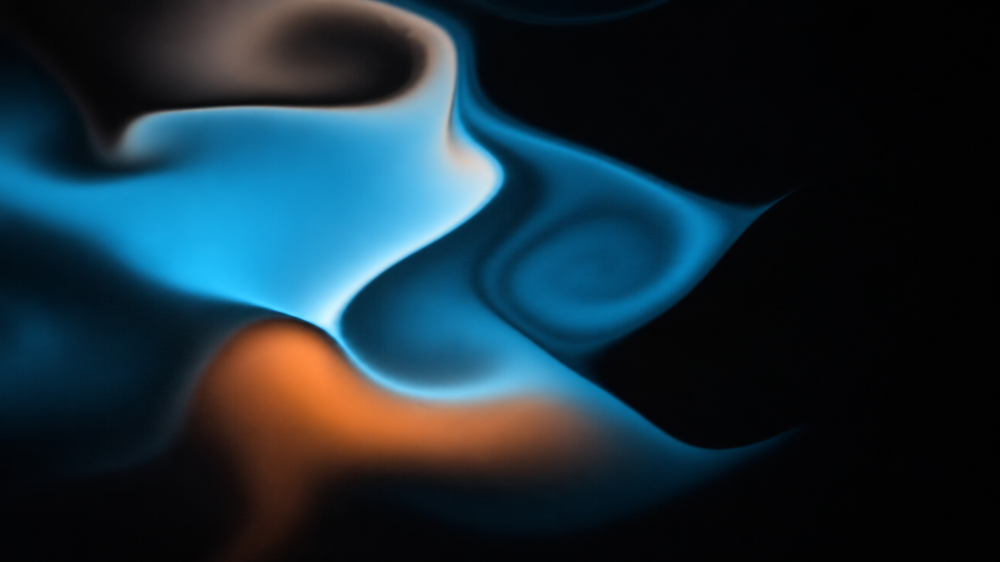

# sonora

A visual instrument for whatever's playing. Sonora listens to your system audio on Windows and paints it, live, in styles built to look like art rather than a spectrum analyser.

Built with Rust, TypeScript, raw WebGL 2 and Tauri 2.

<p align="center">
  <a href="https://www.youtube.com/watch?v=kDKyOMpcxeI" title="Watch Sonora — Flow Ink with sound">
    
  </a>
</p>
<p align="center"><a href="https://www.youtube.com/watch?v=kDKyOMpcxeI"><strong>▶ Flow Ink (v0.1) with sound</strong></a></p>

## Flow Ink 2.0

The flagship style is a real fluid simulation: stable fluids (advection, pressure projection, vorticity confinement) on a periodic world several screens wide, with ink advected at high resolution so it stretches into fine filaments.

- **Depth view (default):** the ink becomes a lit, displaced surface; a camera glides low over it through fog, banks on beats and lurches on drops. **Flat** is a drifting top-down view.
- **Looks:** **Ink** (luminous palette ink on night), **Sumi** (black ink on bone paper), **Marble** (duotone marbling with stipple grain). Each has a light or dark background.
- **Listening:** mid-range presence feeds ink inflow, bass hits throw ink in from all sides (including off-screen), highs scatter fine sparkle, intensity drives turbulence and camera speed, and a detected drop fires a burst plus a camera lurch. Silence lets the ink settle and fade.

Aura and Halo from v0.1 remain available under **Show classic styles** in settings.

## How it works

```text
WASAPI loopback (desktop)        Web Audio + AudioWorklet (browser)
            \                      /
             sonora-dsp (Rust; native or WebAssembly)
             FFT → bands → per-band normalisation → onsets → beat/tempo
             mapping layer: fade, intensity, presence ×7, hits ×7, 96-bin spectrum
                          |
                 AudioFeatureFrame, 60 per second of audio
                          |
   event layer (drop, build, breakdown, big hit, track change)
                          |
   style (world camera, palette, quality) → bloom / tonemap / grain → screen
```

The same analysis crate runs in the desktop app and in the browser; a parity check confirms both produce the same frames. Instrument and section labels are heuristics derived from band energy and onsets, not source separation or machine learning.

## Controls

| Key | Action |
| --- | --- |
| `F11` / `F` | Fullscreen |
| `H` | Clean mode (hide all UI) |
| `D` | Debug overlay (signals, events, fps) |
| `S` | Next style |
| `V` | Depth / Flat |
| `1`–`0` | Palette |
| `Esc` | Leave fullscreen / clean mode, close panels |

Settings: style and look, view, background, palette (presets, duotones, custom hue), Auto Drift (slow hue rotation, 1–10 min per cycle), responsiveness, quality (Low / Medium / High / Auto), audio source. The tray menu offers Show, Hide, Fullscreen and Quit.

Quality presets change real work, not only post effects: render resolution, simulation and ink resolution, solver iterations and mesh density. Auto watches frame time and steps down or up.

## Build from source

Windows, with:

- Node.js 20+ and npm
- stable Rust (MSVC) with the WebAssembly target: `rustup target add wasm32-unknown-unknown`
- `wasm-pack`: `cargo install wasm-pack`
- Microsoft C++ Build Tools (Desktop development with C++), WebView2
- the VBSCRIPT optional feature for MSI packaging

See the [Tauri prerequisites](https://v2.tauri.app/start/prerequisites/).

```powershell
npm ci
npm run tauri dev        # desktop app with system audio
npm run dev:web          # renderer in a browser: test tracks, audio files, mic, tab audio
npm run tauri build      # installers in target/release/bundle/
```

### Verification

```powershell
npm run gen:audio                                   # procedural test tracks (no copyrighted music)
npm run check:parity -- house-124                   # desktop vs browser analysis frames
npm run verify -- --variant sumi --track all        # screenshots at silence/fade-in/build/drop/breakdown
```

`npm run verify` renders in a real browser on the GPU, in audio time, and writes screenshots, an 8-frame strip across the drop, the detected events and frame timing to `verify/`.

## Audio and privacy

Audio stays in memory and is never saved or uploaded. Only derived feature frames reach the renderer. There is no telemetry or network client in the desktop app. Preferences and window state are stored locally in the app-data directory (the browser build uses localStorage).

## Known limitations

- Devices are pinned by display name, not a stable endpoint id.
- Requires WebGL 2 with float render targets.
- Tempo on half-time music may read at half the notated BPM.
- The Tauri content security policy is unset.

Deeper reading: [visual direction](DOCS/16-VISUAL-DIRECTION.md) · [mapping layer](DOCS/14-MAPPING-LAYER-SPEC.md) · [brand](DOCS/brand/17-BRAND.md) · [decisions](DOCS/DECISIONS.md).
