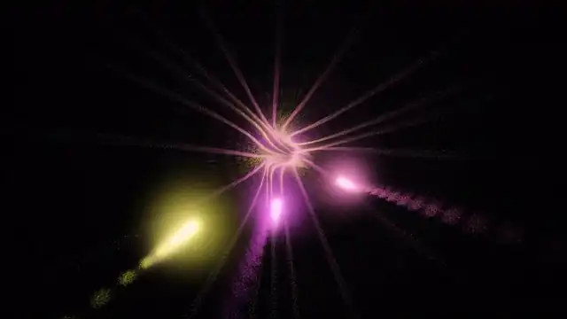
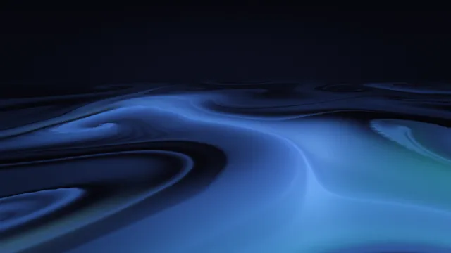
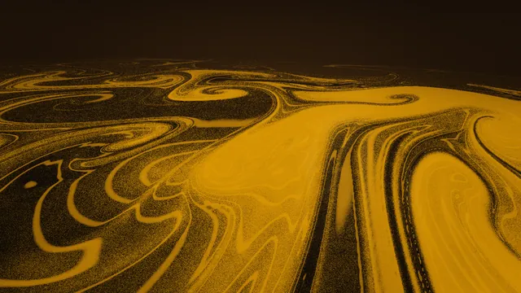
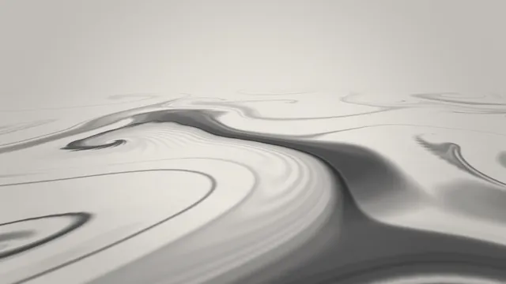
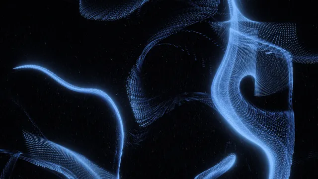
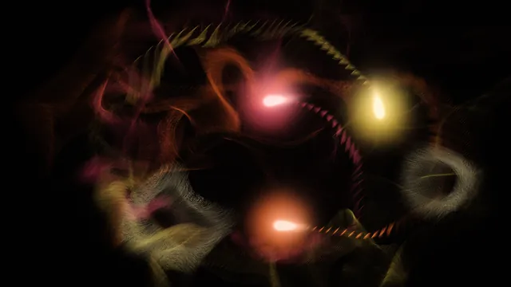
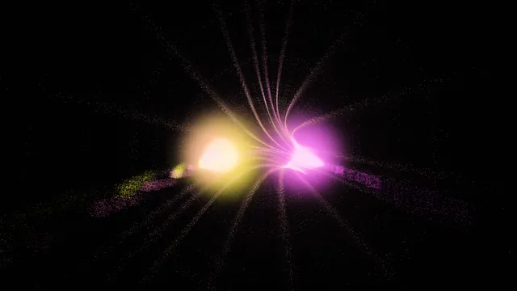
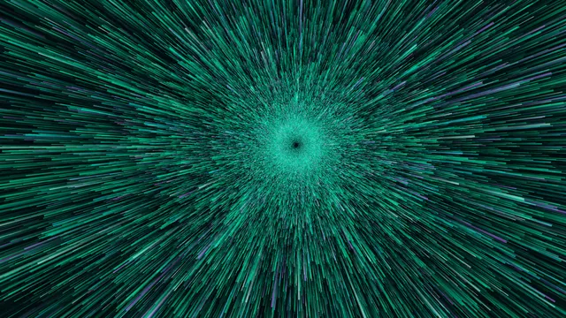
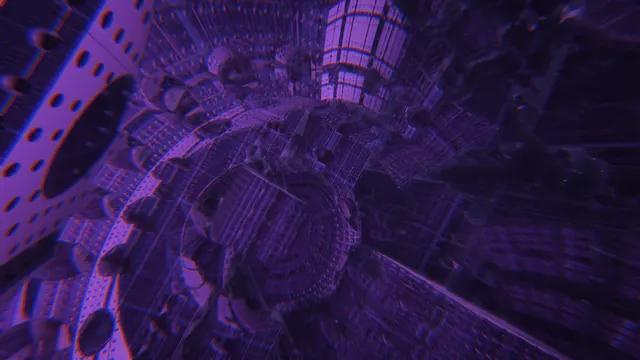
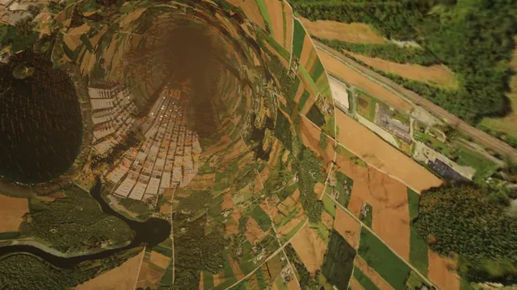

<p align="center">
  <picture>
    <source media="(prefers-color-scheme: dark)" srcset="DOCS/brand/sonora-lockup-bone.svg">
    
  </picture>
</p>

<p align="center"><strong>see your music.</strong><br>a visual instrument for whatever’s playing — a Windows music visualizer that listens to your PC and paints it, live, in time with every beat.</p>

<p align="center">
  <a href="https://github.com/abdulaz06/sonora/releases/latest"></a>
</p>
<p align="center"><a href="https://sonora-visual.vercel.app"><strong>sonora-visual.vercel.app</strong></a> · <a href="https://sonora-visual.vercel.app/live">try it live in your browser</a> · <a href="https://sonora-visual.vercel.app/media/sonora-trailer.mp4">watch the trailer</a> · <a href="https://sonora-visual.vercel.app/engineering">how it works</a></p>

<p align="center"><a href="https://sonora-visual.vercel.app/media/sonora-trailer.mp4"></a></p>
<p align="center"><sub>rendered by the engine on an original demo track · <a href="https://www.youtube.com/watch?v=kDKyOMpcxeI">early version (v0.1) demo</a></sub></p>

## Styles

Five art styles, each with its own looks and views. Every frame below is a real render from the engine.

| | | |
|---|---|---|
| <br>**Ink** · Glow — liquid ink that blooms on every kick | <br>**Ink** · Marble — two-tone marbling | <br>**Ink** · Sumi — black ink on bone paper |
| <br>**Silk** — millions of points of light pulled into threads | <br>**Wisp** — three flames shedding smoke rings on the bass | <br>**Wisp** · Tunnel — chase the flames down an endless tunnel |
| <br>**Warp** — hyperspace that follows the song’s pace | <br>**Voyage** — a flight through a 3D fractal | <br>**Voyage** · City — a curved world wraps around it |

Looks: Ink (Glow, Marble, Sumi), Wisp Depth (Ground, Tunnel), Voyage (Void, City, Ocean). Views: **Depth** (a 3D camera that glides, banks on beats and lurches on drops) or **Flat** (a 2D canvas) for Ink, Silk and Wisp. Aura and Halo from v0.1 live under *Show classic styles*.

## What’s new in 1.0.1

- **Nine palettes on keys 1–9**, tuned in OKLCH to stay vivid in every style, look and view: Ocean, Aurora, Ember, Neon, Crimson, Solar, Violet, Sunset, Acid. Voyage now takes the palette across the whole fractal, its sky and its sea; Wisp's smoke stays coloured; custom colours and colour drift never go muddy, and palette changes fade without passing through grey.
- **Smoother Ink.** Drops grow into the flow instead of popping in, Marble's fine lines no longer break up, and Ink looks the same at any refresh rate.
- **Frame rate matches the display** by default (every frame on 144 or 165 Hz screens), with even half / third rates, and an optional FPS counter (`P`).
- **The website**, with the engine running live on an original demo track, a [try-it-live page](https://sonora-visual.vercel.app/live) (a file, the microphone or a browser tab) and the [engineering story](https://sonora-visual.vercel.app/engineering).

## What’s new in 1.0

- **A home menu.** Every launch opens on a menu of the five styles; hover one to watch it move, open it to compare looks and views side by side, and press Start: the thumbnail grows into the live visual. Continue picks up where you left off.
- **First run.** A short intro explains what sonora is, checks that it can hear your music (with plain advice if it can’t) and defines the four words you need: style, look, view, palette.
- **Set Mode.** Let sonora choose, like a VJ: it switches style, look and view when the track changes, or on a big drop after a long build, picking calm visuals for calm music and driving ones for four-on-the-floor. Never more often than you allow.
- **Now playing.** The song, artist and cover from Spotify, browsers or any player that reports to Windows, shown for a few seconds when the track changes, with previous / play / next. Real track changes also tell the visuals a new song started.
- **Settings for everyone.** Every control has an (i) card that explains it, with pictures where words aren’t enough (Smooth vs Punchy, Depth vs Flat, camera presets, quality). Palettes are shown on the current style.
- **A proper Windows app.** Updates from GitHub with one click, a tray menu (Menu, Set Mode, Fullscreen), fullscreen on the display you choose, devices remembered by their Windows id, and a clear message instead of a black screen on graphics cards that can’t run it.

## How it works

```text
WASAPI loopback (desktop, Rust)         Web Audio + AudioWorklet (browser)
                 \                        /
        sonora-dsp — one Rust crate, native or WebAssembly
        FFT → bands → per-band normalisation → onsets → beat / tempo
        mapping layer: fade, intensity, presence ×7, hits ×7, spectrum
                              |
                AudioFeatureFrame, 60 per second of audio
                              |
        event layer: drop · build · breakdown · big hit · track change
                              |
        WebGL 2 style (world camera, palette, quality) → bloom / tonemap / grain
```

The same analysis crate runs in the desktop app and in the browser (a parity check confirms they produce the same frames), so the renderer can be developed and verified in a plain browser. The home menu shows pre-rendered media only: the engine stops rendering while it’s open and keeps listening, so meters stay live.

## Guarantees, enforced by a harness

A verification harness renders any style against generated test tracks in a real browser on the GPU, deterministically in audio time, and checks:

- **Beat sync** — every art look visibly reacts to ≥ 90% of kicks (`--sync`, whole-screen and regional).
- **Flicker** — fewer than 2.5 large brightness swings per second either way, no single-frame jump over 0.12, at most 6% blown out, on a loud, dense track at Punchy (`--flicker`). Every deliberate flash goes through a WCAG 2.3.1 limiter.
- **Motion** — big shapes move, not fine shimmer: fine-detail share ≤ 45% and a steady background (`scripts/motion-check.py`).
- **Cost** — synced frame cost per style at 1080p (1–6 ms on a laptop GPU at Medium).

The same harness renders every thumbnail and preview loop in the app (`npm run media`).

## Keyboard

| Key | Action |
| --- | --- |
| `F` / `F11` | Fullscreen |
| `Esc` | Back / menu |
| `H` | Hide everything (clean mode) |
| `M` | Set Mode on / off |
| `S` | Next style |
| `V` | Next look (or view) |
| `1`–`9` | Palettes |
| `D` | Audio signals (advanced) |
| `C` | Next camera preset (Depth) |
| Arrows / Enter | Move around the menu |

## Privacy

sonora analyses sound on your computer only. No audio, song titles or usage data ever leave it. The only network request is the update check against GitHub Releases, which you can turn off in Settings › System.

## Install

Download the installer from [Releases](https://github.com/abdulaz06/sonora/releases/latest). The installers aren’t code-signed yet, so Windows SmartScreen may warn on first launch: choose **More info → Run anyway**.

## Build from source

Windows, with Node.js 20+, stable Rust (MSVC) plus `rustup target add wasm32-unknown-unknown`, `cargo install wasm-pack`, the Microsoft C++ Build Tools and WebView2 ([Tauri prerequisites](https://v2.tauri.app/start/prerequisites/)).

```bash
npm install
npm run tauri dev                 # desktop app with real system audio
npm run dev:web                   # renderer in the browser, http://localhost:5173/web.html
npm run tauri build               # NSIS + MSI installers
npm test                          # settings migration, Set Mode, event layer
npm run test:smoke                # menu → detail → visual → menu in a real browser
cargo test --workspace            # DSP on synthetic signals
npm run verify -- --style ink --variant glow --track house-124 --sync
npm run media                     # re-render every thumbnail and loop
```

## Tech

Rust (cpal WASAPI loopback, a platform-free DSP crate, wasm-bindgen, the Windows media session API) · TypeScript strict · raw WebGL 2 (GPU fluids and particles, raymarching, HDR post) · Tauri 2 (updater, tray) · Playwright + system Edge for verification · Vitest.

## Roadmap

- Steam release
- More styles
